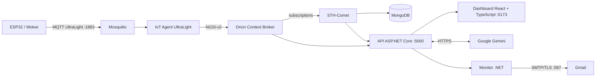

<div align="center">

# 🌱 Irrigação Inteligente

### Supervisão agrícola com IoT, FIWARE, AWS e Inteligência Artificial

*Do sensor à tomada de decisão: telemetria, histórico, alertas e uma experiência de monitoramento integrada.*

<br>


<br>


<br>

**Projeto acadêmico · Sistemas Embarcados · Engenharia de Computação · FESA · 2026**

</div>

---

## 📑 Navegação

1. [Visão geral](#visao-geral)
2. [Funcionalidades e diferenciais](#funcionalidades)
3. [Arquitetura da solução](#arquitetura)
4. [Hardware e pinagem](#hardware)
5. [Telemetria e histórico](#telemetria)
6. [Limites e alertas](#limites)
7. [Tecnologias utilizadas](#tecnologias)
8. [Implantação na AWS e execução](#implantacao)
9. [Endpoints e testes](#endpoints)
10. [Estrutura do repositório](#estrutura)
11. [Segurança e observações](#seguranca)
12. [Referências técnicas](#referencias)
13. [Equipe](#equipe)
14. [Manual do Usuário](#manual)

---

<a id="visao-geral"></a>

## 🎯 Visão geral

O **Irrigação Inteligente** é um protótipo acadêmico de monitoramento ambiental e apoio à irrigação. Um **ESP32 simulado no Wokwi** coleta informações do solo, do ambiente e de um reservatório de água, publica a telemetria por **MQTT** e integra os dados à plataforma **FIWARE**, executada em uma instância **Amazon EC2 (Ubuntu)** no **AWS Learner Lab**. Os materiais do projeto também apresentam uma simulação de **controle local da irrigação**, com acionamento de bomba e válvula, proteção contra falta de água, LED e buzzer.

A aplicação apresenta leituras atuais, gráficos de histórico, faixas de atenção e criticidade e um **assistente conversacional com Google Gemini**, capaz de responder a perguntas com base nos dados recebidos. Um monitor independente em **.NET** verifica o reservatório periodicamente e pode emitir alertas por e-mail.

> 🎯 **Objetivo:** permitir que o usuário acompanhe remotamente as condições da plantação, identifique anomalias e tome decisões mais informadas sobre a irrigação.

---

<a id="funcionalidades"></a>

## ✨ Funcionalidades e diferenciais

| Funcionalidade | O que oferece |
|---|---|
| 📡 **Telemetria IoT** | Leitura e envio periódico de seis atributos do ESP32 via MQTT/UltraLight. |
| 📊 **Dashboard responsivo** | Estado atual de solo, reservatório, temperatura, luminosidade e demais variáveis. |
| 🔄 **Atualização automática** | Intervalos selecionáveis de 5, 15 ou 30 segundos, além de pausa e atualização manual. |
| 🗃️ **Histórico persistente** | Séries de solo, luminosidade e reservatório via STH-Comet + MongoDB; até 30 pontos por gráfico na interface. |
| 🚦 **Alertas visuais** | Estados de normalidade, atenção e criticidade para umidade do solo, nível do reservatório e temperatura ambiente. |
| 💧 **Irrigação automática no Wokwi** | Regras de acionamento/desligamento por umidade do solo, com bloqueio por reservatório baixo, conforme o fluxograma do circuito complementar. |
| ⚙️ **Bomba e válvula simuladas** | Dois motores controlados por drivers A4988 na configuração apresentada no mapa do ESP32. |
| 🔔 **Alarme local** | LED e buzzer associados ao bloqueio da irrigação por nível baixo ou falha de leitura na simulação ilustrada. |
| ✉️ **Alerta por e-mail** | Monitor em .NET consulta o nível de água a cada cinco minutos e utiliza Gmail SMTP quando o limite é excedido. |
| 🤖 **IA conversacional** | Chat com Gemini que utiliza medições atuais e até dez leituras históricas por variável consultada. |
| 🔐 **Chave de IA no backend** | A chave `GEMINI_API_KEY` não é enviada ao navegador. |

---

<a id="arquitetura"></a>

## 🧩 Arquitetura da solução



1. **Aquisição:** o ESP32 simulado coleta as leituras e publica mensagens no formato UltraLight.
2. **Transporte:** o Mosquitto recebe os dados MQTT pela porta `1883`.
3. **Contexto:** o FIWARE IoT Agent UltraLight interpreta a telemetria, e o Orion Context Broker mantém o estado atual da entidade `Sensor:irrig001`.
4. **Persistência:** subscriptions do Orion encaminham as atualizações para o STH-Comet, com histórico armazenado no MongoDB.
5. **Aplicação:** a API ASP.NET Core consulta Orion e STH-Comet e expõe endpoints HTTP/JSON consumidos pelo React + TypeScript.
6. **Serviços complementares:** o backend consulta a API Gemini para responder às perguntas; um monitor .NET independente consulta a API e usa SMTP/TLS para os avisos do reservatório.

> [!IMPORTANT]
> **Atenção à diferença entre telemetria e comando:** o fluxo acima documenta a coleta e a supervisão presentes nos arquivos fornecidos. O retorno de comandos ao ESP32 para LED e buzzer, previsto na rubrica da disciplina, deve ser documentado com o firmware de controle correspondente (ver [Limites e alertas](#limites)).

> [!NOTE]
> **Duas visões complementares:** o diagrama acima descreve a supervisão conectada à AWS, enquanto as imagens na seção de hardware apresentam o controle local de motores no Wokwi. As pinagens não são iguais entre os materiais, portanto não devem ser tratadas como um único sketch sem conferir a versão final do circuito.

### Protocolos e portas

| Componente | Porta / tecnologia | Uso |
|---|---|---|
| ESP32 ↔ Mosquitto | `1883` / MQTT | Publicação da telemetria. |
| IoT Agent UltraLight | `4041` (admin), `7896` (HTTP) | Provisionamento e integração de dispositivos. |
| Orion Context Broker | `1026` / NGSI-v2 | Contexto e últimas leituras. |
| STH-Comet | `8666` / HTTP | Consulta das séries históricas. |
| MongoDB | `27017` | Persistência dos dados, em rede interna. |
| API ASP.NET Core | `5000` / HTTP | Acesso aos dados e integração com a IA. |
| Frontend React/Vite | `5173` / HTTP | Interface web do usuário. |
| Gmail SMTP | `587` / TLS | Envio de alertas por e-mail. |
| Google Gemini | `443` / HTTPS | Processamento das perguntas pelo modelo de IA. |

---

<a id="hardware"></a>

## 🛠️ Hardware e pinagem

O projeto utiliza o **ESP32 no Wokwi**. Os materiais recebidos documentam **duas configurações de pinos**, descritas separadamente para preservar a correspondência com cada fonte.

### 1. Circuito de irrigação automática

<br>

| Componente | Conexão no ESP32 | Função |
|---|---|---|
| Potenciômetro | GPIO 34 (SIG) | Simula a umidade do solo por leitura analógica de 0 a 4095. |
| DHT22 | GPIO 4 (DATA) | Temperatura e umidade do ar; apenas monitoramento nessa lógica. |
| HC-SR04 | GPIO 15 (TRIG) e GPIO 2 (ECHO) | Mede a distância até a água. |
| LED vermelho | GPIO 19, com resistor de 220 Ω | Sinalização de alarme. |
| Buzzer | GPIO 13 (+), com negativo no GND | Alerta sonoro. |
| A4988 #1 + Motor 1 | GPIO 14 (STEP) e GPIO 12 (DIR) | Simula a **bomba**. |
| A4988 #2 + Motor 2 | GPIO 26 (STEP) e GPIO 27 (DIR) | Simula a **válvula**. |

> [!WARNING]
> **Alimentação e cuidados:** os componentes compartilham GND comum, a lógica do ESP32 utiliza 3,3 V e os motores precisam de alimentação externa adequada aos drivers. Em montagem física, o pino ECHO do HC-SR04 alimentado a 5 V deve ter o sinal adaptado aos 3,3 V do ESP32. Os GPIOs 2, 12 e 15 também exigem atenção por participarem da configuração de inicialização da placa.

### 2. Firmware de telemetria para FIWARE/AWS (`sketch.ino`)

O trecho de código para publicação MQTT utiliza outro mapeamento:

| Componente | Função | GPIO no `sketch.ino` de telemetria |
|---|---|---|
| DHT22 #1 | Temperatura ambiente e umidade do ar | 4 |
| DHT22 #2 | Temperatura do solo (sensor do protótipo) | 5 |
| LDR | Luminosidade (leitura ADC) | 34 |
| Sensor de umidade do solo | Umidade do solo (leitura ADC) | 35 |
| HC-SR04 | Distância entre sensor e superfície da água | TRIG 18 / ECHO 19 |
| Saída da bomba | GPIO configurado como saída, inicializado desligado | 26 |

#### Observações para conciliar as versões

- O código disponibilizado utiliza **DHT22**, enquanto o enunciado mínimo da disciplina menciona **DHT11**. É necessário confirmar com o professor a aceitação dessa substituição.
- No sketch de telemetria, a luminosidade é lida com `analogRead()` e apresentada na escala 0 a 4095. Já no mapa do controle local, o GPIO 34 recebe o potenciômetro que simula a umidade do solo.
- No código MQTT, a umidade do solo é convertida para 0 a 100% usando `map()`.
- O GPIO 26 foi declarado para a bomba no sketch MQTT, mas corresponde ao STEP do segundo motor no mapa complementar. **Não utilize as duas descrições para conectar o mesmo circuito sem conferir o código final.**
- O LED vermelho e o buzzer estão documentados nas imagens do controle local; suas rotinas não constam do código de telemetria analisado. O professor pede **LED azul** na rubrica, outra diferença que precisa ser validada.

---

<a id="telemetria"></a>

## 📡 Telemetria e histórico

### Dados publicados

| Atributo FIWARE | Grandeza | Unidade / representação |
|---|---|---|
| `tempAmb` | Temperatura ambiente | °C |
| `humidityAir` | Umidade do ar | % |
| `tempSoil` | Temperatura do solo | °C |
| `soil` | Umidade do solo | % (0–100) |
| `light` | Luminosidade | Valor ADC bruto (0–4095) |
| `waterLevel` | Distância até a superfície da água | cm |

O firmware transmite uma leitura aproximadamente **a cada 5 segundos**, no formato `atributo|valor`:

```text
soil|69
waterLevel|216.9
light|3987
```

No código fornecido, o tópico de publicação aparece como:

```text
/TEF/irrig001/attrs
```

> [!TIP]
> **Conferência de provisionamento:** o tópico deve coincidir com a configuração efetiva do IoT Agent. Na convenção MQTT/UltraLight documentada pelo FIWARE, o tópico de medidas normalmente contém protocolo, chave do serviço e ID do dispositivo. Confira o tópico e o provisionamento usados na demonstração antes de publicar os comandos de instalação.

- **Entidade de contexto:** `Sensor:irrig001`
- **Cabeçalhos FIWARE:** `fiware-service: smart` e `fiware-servicepath: /`

### Histórico e cálculo do reservatório

As subscriptions do Orion registram três séries: **umidade do solo** (`soil`), **luminosidade** (`light`) e **distância da água** (`waterLevel`). O backend consulta o STH-Comet e o frontend exibe até **30 leituras recentes por gráfico**.

> [!NOTE]
> **Conferência com a rubrica:** os gráficos deste protótipo registram solo, reservatório e luminosidade. O enunciado cita histórico de temperatura, umidade e luminosidade; confirme se a versão final do repositório inclui também os gráficos pedidos pelo professor.

Para oferecer uma visualização intuitiva do reservatório, a aplicação converte distância em nível estimado:

$$
\text{Nível estimado (\%)} = \min\left(100,\ \max\left(0,\ \frac{400 - d}{400} \times 100\right)\right)
$$

Em que **d** é a distância medida em centímetros. Na simulação: **0 cm = 100%** de nível e **400 cm = 0%**. Portanto, quanto maior a distância, menor a quantidade de água estimada.

---

<a id="limites"></a>

## 🚨 Limites e alertas

### Controle local da irrigação (Wokwi)

Segundo o fluxograma e o mapa do circuito complementar, o ESP32 executa as seguintes regras de decisão na simulação:

| Condição medida | Decisão | Bomba e válvula | LED e buzzer |
|---|---|---|---|
| Distância ao reservatório **> 20 cm**, ou falha na leitura | Bloquear irrigação por segurança, independentemente da umidade | Desligados | Alarme ativado (GPIO 19 e GPIO 13) |
| Água disponível (≤ 20 cm) e solo **< 35%** | Ligar irrigação | Ligados | Sem indicação de alarme no fluxograma |
| Água disponível (≤ 20 cm) e solo de **35% a < 65%** | Manter o estado anterior | Mantêm o estado | Sem indicação de alarme no fluxograma |
| Água disponível (≤ 20 cm) e solo **≥ 65%** | Desligar irrigação | Desligados | Sem indicação de alarme no fluxograma |

Essa faixa intermediária cria uma **histerese operacional**: o sistema liga quando o solo está seco e só desliga ao alcançar 65%, evitando alternâncias a cada pequena oscilação. O DHT22 é monitorado, mas não altera a decisão de irrigação apresentada nessas imagens.

**Exemplos de teste documentados nas imagens:**

| Umidade do solo | Distância da água | Resultado esperado na simulação |
|---|---|---|
| 20% | 10 cm | ✅ Irrigação ligada |
| 75% | 10 cm | ⏹️ Irrigação desligada |
| 20% | 30 cm | 🚨 Irrigação bloqueada e alarme ativado |

Nas imagens, a atualização é indicada como a cada **5 segundos** para solo/clima e a cada **10 segundos** para o reservatório. Esses intervalos se referem à simulação local ilustrada e não ao monitor de e-mail na EC2.

### Classificação exibida no dashboard

| Variável | Normal 🟢 | Atenção 🟡 | Crítico 🔴 |
|---|---|---|---|
| Umidade do solo | ≥ 30% | 15% ≤ solo < 30% | < 15% |
| Nível estimado da água | ≥ 20% | 10% ≤ nível < 20% | < 10% |
| Temperatura ambiente | ≤ 32 °C | 32 °C < temp. ≤ 38 °C | > 38 °C |
| Luminosidade | Sem limite configurado no frontend enviado | — | — |

O frontend ordena avisos de criticidade antes dos de atenção. Na ausência dessas anomalias e de erro de comunicação, apresenta **“Nenhum alerta ativo”**. As classificações acima usam as leituras atuais, não médias móveis.

### Alerta automático por e-mail

O monitor .NET consulta `GET /api/current` **a cada 5 minutos**. Quando `waterLevel > 300 cm`, prepara um e-mail de alerta pelo Gmail SMTP (`smtp.gmail.com:587`). Esse valor representa nível estimado inferior a 25% na escala adotada. Trata-se de um limite próprio do monitor, diferente das faixas visuais do dashboard.

### Sinalização física exigida na avaliação

A rubrica da disciplina pede, além do alarme local de reservatório ilustrado acima, que a aplicação **compare médias em uma janela definida**, **envie comandos ao ESP32** e utilize **LED azul piscando + buzzer com tons diferentes** para temperatura, umidade e luminosidade, com prioridade definida quando ocorrerem anomalias simultâneas.

| Condição física exigida | LED azul | Buzzer | Prioridade |
|---|---|---|---|
| Temperatura fora do limite | A confirmar no firmware final | Frequência a informar | A definir |
| Umidade fora do limite | A confirmar no firmware final | Frequência a informar | A definir |
| Luminosidade fora do limite | A confirmar no firmware final | Frequência a informar | A definir |
| Todas dentro dos limites | Desligado (exigência) | Desligado (exigência) | Não se aplica |

> [!CAUTION]
> **Pendente de conciliação com os arquivos do projeto:** as imagens documentam LED, buzzer e controle local de dois motores, mas não demonstram alertas distintos para temperatura, umidade e luminosidade, nem o envio de comandos pelo Orion com base em médias. Esta tabela registra o requisito específico do professor, não uma funcionalidade verificada. Antes da entrega, substitua os campos de confirmação pelas frequências, prioridades e rotinas efetivamente utilizadas.

### 🤖 Assistente de IA

- **Endpoint:** `POST /api/ai-chat`
- **Modelo declarado no backend:** `gemini-3.5-flash-lite`
- **Contexto enviado:** estado atual dos seis atributos e até dez registros históricos para solo, água e luminosidade.
- **Interação:** perguntas livres e sugestões como *“Preciso irrigar agora?”* ou *“Como está o reservatório?”*.
- **Segurança operacional:** a IA oferece orientações e análises; **não liga nem desliga a bomba**. A atuação automática mostrada no Wokwi é uma lógica local do ESP32, independente do chat.

---

<a id="tecnologias"></a>

## 🧰 Tecnologias utilizadas

| Camada | Ferramentas |
|---|---|
| **Simulação / dispositivo** | Wokwi, ESP32, C/C++, DHT22, LDR, potenciômetro/sensor de solo, HC-SR04, LED, buzzer, dois drivers A4988 e motores simulados |
| **Mensageria** | MQTT, Eclipse Mosquitto, UltraLight 2.0 |
| **Plataforma IoT** | FIWARE IoT Agent UltraLight, Orion Context Broker (NGSI-v2), STH-Comet |
| **Dados** | MongoDB (contexto e histórico em serviços separados) |
| **Nuvem** | AWS Learner Lab, Amazon EC2, Ubuntu, Docker |
| **Backend** | C#, ASP.NET Core, HTTP/JSON |
| **Frontend** | React, TypeScript, Vite, Axios, Recharts |
| **IA** | Google Gemini API |
| **Notificações** | Monitor .NET, Gmail SMTP; Amazon SNS com teste manual representado no diagrama |

---

<a id="implantacao"></a>

## 🚀 Implantação na AWS e execução

### 1. Pré-requisitos

- [ ] Conta e acesso ao **AWS Learner Lab** da disciplina.
- [ ] Instância **EC2 Ubuntu** com acesso SSH.
- [ ] **Docker + Docker Compose**, **.NET SDK** e **Node.js/npm** instalados na instância.
- [ ] Projeto ESP32 configurado no **Wokwi**.
- [ ] Arquivos do projeto: firmware `sketch.ino`, configuração Docker da plataforma FIWARE, API, frontend, monitor e JSON de subscriptions.
- [ ] Chave da **Google Gemini API** e, para e-mail, credenciais SMTP de aplicativo.

> [!NOTE]
> O código e a imagem disponibilizados não incluem o arquivo `docker-compose.yml`, os JSON de provisionamento do device e os arquivos completos de configuração da infraestrutura. Para que o repositório seja reproduzível do zero, esses arquivos reais também devem ser versionados **sem credenciais**.

### 2. Inicializar o Learner Lab e preparar a EC2

1. Inicie a sessão do AWS Learner Lab.
2. Inicie a instância EC2 Ubuntu com Docker, .NET e Node.js disponíveis.
3. Copie o novo **IP público** da instância — ele pode mudar a cada sessão.
4. No **Security Group**, permita apenas as conexões necessárias ao teste:

| Porta | Finalidade | Acesso recomendado |
|---|---|---|
| `22/TCP` | SSH | Seu IP |
| `1883/TCP` | MQTT do ESP32/Wokwi | Origem estritamente necessária para a simulação |
| `5000/TCP` | API ASP.NET Core | IPs da equipe / demonstração |
| `5173/TCP` | Dashboard Vite | IPs da equipe / demonstração |

> [!WARNING]
> Mantenha MongoDB, IoT Agent administrativo, Orion e STH-Comet acessíveis internamente sempre que possível. **Não exponha portas de banco de dados à internet.**

### 3. Subir os serviços FIWARE

Conecte-se por SSH, acesse a pasta que contém o Docker Compose efetivamente utilizado no projeto e execute:

```bash
docker compose up -d
docker compose ps
```

Confirme o funcionamento de **Mosquitto**, **IoT Agent UltraLight**, **Orion Context Broker**, **STH-Comet** e das instâncias de **MongoDB**. A rede interna dos containers deve permitir a comunicação entre esses serviços.

### 4. Provisionar o dispositivo e configurar o histórico

Com o IoT Agent operacional:

1. Cadastre o *service group* do FIWARE por `POST http://localhost:4041/iot/services`.
2. Cadastre o ESP32 por `POST http://localhost:4041/iot/devices`, vinculando o dispositivo à entidade `Sensor:irrig001` e aos atributos apresentados na [tabela de telemetria](#telemetria).
3. Utilize os cabeçalhos `fiware-service: smart` e `fiware-servicepath: /`.
4. Verifique se a API key, o identificador de dispositivo e o tópico MQTT do sketch são consistentes com o provisionamento.
5. Crie as três subscriptions com os arquivos `light-history.json`, `soil-history.json` e `water-history.json` usados no projeto:

```bash
curl -i -X POST http://localhost:1026/v2/subscriptions \
  -H 'Content-Type: application/json' \
  -H 'fiware-service: smart' \
  -H 'fiware-servicepath: /' \
  -d @light-history.json

curl -i -X POST http://localhost:1026/v2/subscriptions \
  -H 'Content-Type: application/json' \
  -H 'fiware-service: smart' \
  -H 'fiware-servicepath: /' \
  -d @soil-history.json

curl -i -X POST http://localhost:1026/v2/subscriptions \
  -H 'Content-Type: application/json' \
  -H 'fiware-service: smart' \
  -H 'fiware-servicepath: /' \
  -d @water-history.json
```

> Execute os comandos acima no diretório que contém os respectivos arquivos JSON. O processo de criação do service group/device precisa ser executado conforme os arquivos reais da equipe; os payloads de provisionamento não foram fornecidos neste material.

### 5. Configurar e iniciar a API ASP.NET Core

Na instância EC2, carregue a variável de ambiente da IA **sem incluí-la no GitHub**. Por exemplo, na sessão que executará o backend:

```bash
export GEMINI_API_KEY='SUA_CHAVE_AQUI'
cd ~/irrigacao-api/IrrigacaoApi
dotnet run
```

A API foi configurada para escutar em `http://0.0.0.0:5000`. Em outro terminal, teste:

```bash
curl -s http://localhost:5000/
curl -s http://localhost:5000/api/current
```

O primeiro endpoint deve responder com `API ONLINE` no campo `status`.

### 6. Configurar e executar o dashboard

No arquivo `~/frontend/.env`, configure o IP público atual da EC2:

```env
VITE_API_URL=http://SEU_IP_PUBLICO_EC2:5000
```

Em seguida:

```bash
cd ~/frontend
npm install
npm run dev -- --host
```

No navegador, acesse `http://SEU_IP_PUBLICO_EC2:5173`. Se mudar o IP público, atualize `VITE_API_URL` e reinicie o Vite.

### 7. Configurar e iniciar o ESP32 no Wokwi

1. Abra o circuito no Wokwi com o `sketch.ino` e as bibliotecas **WiFi**, **PubSubClient** e **DHT** disponíveis.
2. Altere `mqtt_server` para o IP público atual da EC2.
3. Confirme o broker na porta `1883`, a pinagem e o tópico provisionado.
4. Execute a simulação; no **Serial Monitor**, acompanhe a conexão Wi-Fi/MQTT e a publicação das leituras.
5. Confira se a entidade `Sensor:irrig001` passa a receber valores no Orion.

### 8. Ativar o monitor de e-mail (opcional)

```bash
export ALERT_EMAIL='SEU_EMAIL'
export ALERT_EMAIL_PASSWORD='SENHA_DE_APLICATIVO'
cd ~/monitor-email
dotnet run
```

O monitor usa o mesmo e-mail como remetente e destinatário e faz uma verificação a cada cinco minutos. Use uma **senha de aplicativo** compatível com o SMTP do Gmail, nunca a senha pessoal da conta.

---

<a id="endpoints"></a>

## 🧪 Endpoints e testes

### API

| Método | Endpoint | Resultado |
|---|---|---|
| `GET` | `/` | Status da API. |
| `GET` | `/api/current` | Estado atual consultado no Orion. |
| `GET` | `/api/history/soil` | Histórico de umidade do solo. |
| `GET` | `/api/history/light` | Histórico de luminosidade. |
| `GET` | `/api/history/water` | Histórico do reservatório. |
| `POST` | `/api/ai-analysis` | Análise textual estruturada por IA. |
| `POST` | `/api/ai-chat` | Resposta conversacional sobre dados atuais e históricos. |

### Testes de integração

```bash
# Estado atual no Orion
curl -s http://localhost:1026/v2/entities/Sensor:irrig001 \
  -H 'fiware-service: smart' \
  -H 'fiware-servicepath: /'

# Subscriptions do Orion
curl -s http://localhost:1026/v2/subscriptions \
  -H 'fiware-service: smart' \
  -H 'fiware-servicepath: /'

# Histórico do solo no STH-Comet
curl -s 'http://localhost:8666/STH/v1/contextEntities/type/Sensor/id/Sensor:irrig001/attributes/soil?lastN=10' \
  -H 'fiware-service: smart' \
  -H 'fiware-servicepath: /'

# Chat integrado à IA
curl -s -X POST http://localhost:5000/api/ai-chat \
  -H 'Content-Type: application/json' \
  -d '{"question":"Como evoluiu o nível do reservatório nas últimas leituras?"}'
```

### ✅ Checklist para a demonstração

- [ ] A EC2 e todos os containers necessários estão ativos.
- [ ] O ESP32 está publicando dados e a entidade no Orion recebe as leituras.
- [ ] O dashboard atualiza sem recarregar a página.
- [ ] Há leituras armazenadas no STH-Comet para as três séries.
- [ ] Limites e alertas visuais respondem a condições simuladas.
- [ ] O chat responde com base nas leituras reais do sistema.
- [ ] Na simulação local, o solo seco liga os motores, o solo úmido os desliga e a falta de água bloqueia o acionamento e ativa o alarme.
- [ ] O monitor de reservatório envia o e-mail no cenário configurado.
- [ ] Validar separadamente os comandos, médias, LED e buzzer solicitados na rubrica.

---

<a id="estrutura"></a>

## 🗂️ Estrutura do repositório

Organização sugerida para facilitar a correção e a reprodução. Adapte os nomes às pastas que vocês realmente versionarem:

```text
irrigacao-inteligente/
├── README.md
├── docs/
│   ├── arquitetura.jpg
│   ├── mapa-esp32.jpg
│   └── fluxo-irrigacao.jpg
├── firmware/
│   ├── sketch.ino                 # versão de telemetria MQTT
│   └── controle-local/            # incluir o sketch correspondente às novas imagens
├── infra/
│   ├── docker-compose.yml         # adicionar o arquivo real utilizado
│   ├── provisionamento/           # adicionar os JSON/scripts reais
│   └── subscriptions/
│       ├── light-history.json
│       ├── soil-history.json
│       └── water-history.json
├── api/
│   └── IrrigacaoApi/
│       └── Program.cs
├── frontend/
│   ├── src/
│   │   ├── App.tsx
│   │   └── App.css
│   ├── package.json
│   └── .env.example               # sem chaves reais
└── monitor-email/
    └── Program.cs
```

> O código do firmware e do frontend deve ficar **comentado e documentado**, sobretudo nos trechos de pinagem, leitura e conversão do LDR, tópicos MQTT, limites, cálculo das médias, endpoints e tratamento dos comandos, conforme a rubrica do professor.

---

<a id="seguranca"></a>

## 🔒 Segurança e observações

- 🚫 **Nunca publique no GitHub:** `GEMINI_API_KEY`, `ALERT_EMAIL_PASSWORD`, credenciais MongoDB, chaves SSH, segredos de serviço ou arquivos `.env` reais.
- 🌐 A instância do Learner Lab pode **mudar de IP público** a cada nova sessão. Atualize o `mqtt_server` do firmware e `VITE_API_URL` do frontend.
- 📶 O broker MQTT do protótipo utiliza a porta `1883`. O tráfego dessa porta **não é criptografado** por padrão; restrinja sua exposição e considere TLS/autenticação fora do ambiente acadêmico.
- 🗄️ Mantenha o banco de dados e as interfaces administrativas acessíveis apenas dentro da rede apropriada.
- 📨 O **Amazon SNS** consta no diagrama como notificação testada manualmente; o fluxo automatizado de alertas demonstrado no código disponibilizado utiliza **Gmail SMTP**.
- 🤖 Não foi implementado pelo chat de IA qualquer acionamento autônomo da bomba; as respostas são orientativas. A atuação dos motores é descrita separadamente na simulação local.

---

<a id="referencias"></a>

## 📚 Referências técnicas

- [FIWARE — IoT Agent UltraLight (documentação)](https://fiware-iotagent-ul.readthedocs.io/)
- [FIWARE — comunicação de IoT por MQTT](https://fiware-tutorials.readthedocs.io/en/latest/iot-over-mqtt.html)
- [Microsoft Learn — ASP.NET Core](https://learn.microsoft.com/aspnet/core/)
- [Wokwi — ESP32](https://docs.wokwi.com/guides/esp32)

---

<a id="equipe"></a>

## 👩‍💻 Equipe

**Curso:** Engenharia de Computação — Faculdade Engenheiro Salvador Arena (FESA)  
**Disciplina:** Sistemas Embarcados — Projeto N2, 2º bimestre de 2026  
**Professor:** Fábio Henrique Cabrini

| Nome completo | RA |
|---|---|
| Evellyn Martins de Santana | 082240035 |
| Giuliana de Toledo Medeiros | 082240006 |
| Letícia Marin Reis | 082240017 |
| Marcos Paulo Vital de Souza | 082240023 |
| Talita Covo de Carvalho | 082240010 |

---

<a id="manual"></a>

## 📖 Manual do Usuário

O manual completo (24 páginas, formato A4) reúne em um só documento a implantação passo a passo, o uso do dashboard e do assistente de IA, o controle local no Wokwi, os cenários de teste, a solução de problemas e a conformidade com a rubrica.

<div align="center">

[](IrrigacaoConfig/Manual%20de%20Instru%C3%A7%C3%B5es%20%E2%80%94%20Irriga%C3%A7%C3%A3o%20Inteligente.pdf)

</div>

| Seção do manual | Conteúdo |
|---|---|
| 1–3 | Introdução, visão geral da arquitetura e requisitos |
| 4 | Hardware e pinagem das duas configurações do ESP32 |
| 5 | Implantação e inicialização (AWS, FIWARE, API, dashboard, Wokwi, e-mail) |
| 6–8 | Dashboard, assistente de IA e notificações por e-mail |
| 9 | Controle local da irrigação e histerese |
| 10–11 | Roteiro de testes (T01–T12) e solução de problemas |
| 12–13 | Encerramento, segurança e conformidade com a rubrica |
| Apêndices | API, estrutura do repositório, glossário, referências e equipe |

> 📄 Arquivo: [Manual de Instruções — Irrigação Inteligente.pdf](IrrigacaoConfig/Manual%20de%20Instru%C3%A7%C3%B5es%20%E2%80%94%20Irriga%C3%A7%C3%A3o%20Inteligente.pdf)

<div align="center">

---

🌿 *Tecnologia aplicada ao campo, dados transformados em informação e decisões mais conscientes.*

<sub>Projeto desenvolvido para fins acadêmicos.</sub>

</div>
